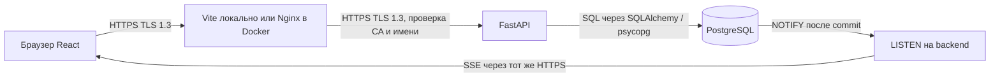
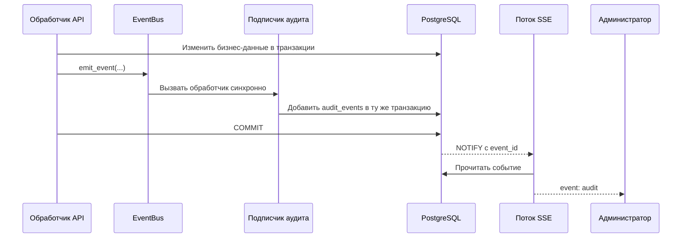
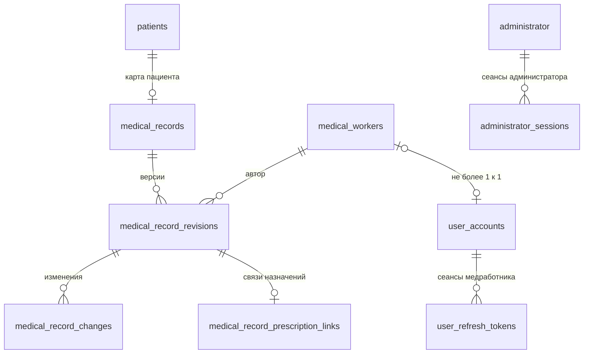

# PsychosIS: разбор ЛР2 для защиты

Подготовлено по текущему коду и структуре PostgreSQL, 30.10.2026.
ИСУ: **368833**. Это учебное объяснение реализации, а не инструкция по настройке
промышленной медицинской системы. Рабочих паролей, TOTP-секретов и ключей в документе нет.

## Как пользоваться этим разбором

Сначала прочитать разделы 1–8: они объясняют путь от входа до сохранения ЭМК.
Затем разобрать схему БД и пройти демонстрацию. В конце — вопросы преподавателя,
короткий рассказ для начала защиты и точные места в исходниках.

## 1. Что добавлено в лабораторной

В приложении есть две области: административная и медицинская. Администратор
управляет медработниками, их аккаунтами и ролями, справочниками и просматривает аудит.
Медработник работает с пациентами и электронными медицинскими картами — ЭМК.

ЛР2 добавляет несколько независимых механизмов:

| Что защищаем | Механизм в моём проекте | Что он делает |
| --- | --- | --- |
| Пароли в БД | Argon2id | Позволяет проверять пароль, не сохраняя его исходный текст |
| Вход администратора | Пароль + TOTP | Требует знания пароля и доступа к приложению-аутентификатору |
| Сеанс после входа | Access/refresh JWT, подпись Ed25519 | Подтверждает, кому выданы токены, и ограничивает срок их действия |
| Передачу данных | TLS 1.3 и сертификаты собственного CA | Шифрует канал и позволяет проверить подлинность сервера |
| Доступ к операциям | Серверные проверки роли и активности | Запрещает операцию даже при обходе интерфейса |
| Историю действий | Неизменяемый аудит, события и SSE | Сохраняет сведения об операциях и доставляет их администратору |

**Аутентификация** отвечает на вопрос «кто вошёл?». **Авторизация** —
«что этому человеку разрешено?». Успешный вход лаборанта не даёт ему права
создать ЭМК или редактировать существующую.

## 2. Как приложение устроено и куда идёт запрос

Frontend написан на React и TypeScript. Backend — FastAPI с SQLAlchemy.
Данные хранятся в PostgreSQL. Сейчас frontend и backend запускаются локально,
PostgreSQL работает в Docker. Предусмотрен и запуск всех трёх частей в Docker.



Браузер обращается к `/api/...` на том же адресе, с которого загружен интерфейс.
Vite или Nginx перенаправляет запрос API. Поэтому браузеру не требуется обращаться
к другому порту API напрямую и настраивать доступ между разными Origin.

Пример: врач нажал «Сохранить» в ЭМК:

1. React отправляет PUT с версией карты, данными и разрешением редактирования.
2. Браузер прикладывает cookie с access JWT.
3. Backend проверяет подпись, тип, аудиторию и срок JWT, затем актуальное состояние
   аккаунта, роли и записи сессии в БД.
4. Проверяется, что это врач и разрешение относится к его сессии и этой версии ЭМК.
5. Создаются новая версия ЭМК и запись аудита в общей транзакции.
6. После commit API возвращает результат, а событие аудита приходит через SSE.

Скрытие кнопки — удобство интерфейса. Реальный запрет находится в backend.

## 3. Пароли: хэширование, соль и Argon2id

### Объяснение простыми словами

Пароль можно представить как ключ, а хэш — как результат его проверки по сложному
шаблону. При входе сервер берёт введённый пароль и проверяет, соответствует ли он
сохранённому результату. Получать исходный пароль из хэша для этого не требуется.

KDF — Key Derivation Function, функция выработки ключевого материала. В этой
работе Argon2id применяется для парольного хэширования: сохраняется проверочное
значение, с которым можно проверить введённый пароль.

Хэширование не является обратимым шифрованием. Но слабый пароль можно **угадать**:
перебирать варианты и проверять каждый. Поэтому для паролей используется специально
дорогая функция Argon2id, а не быстрый SHA-256. Argon2id требует вычислений и памяти,
повышая стоимость массового перебора. Описание алгоритма: [RFC 9106](https://www.rfc-editor.org/rfc/rfc9106.html).

### Что именно записывается

`backend/app/accounts/passwords.py` создаёт хэши через `argon2-cffi`:

| Параметр | Значение в коде | Смысл |
| --- | --- | --- |
| type | Argon2id | Выбранный вариант Argon2 |
| time_cost | 3 | Число проходов вычисления |
| memory_cost | 65536 KiB = 64 MiB | Заданный бюджет памяти для одного вычисления |
| parallelism | 4 | Число параллельных дорожек алгоритма |
| salt_len | 16 байт | Размер случайной соли |
| hash_len | 32 байта | Размер результата |

Единицы `memory_cost` — KiB, согласно [документации argon2-cffi](https://argon2-cffi.readthedocs.io/en/stable/api.html).
Это 64 MiB на вычисление с такими параметрами, а не 64 MiB на каждую дорожку.

Строка в БД схематически выглядит так:

```text
$argon2id$v=19$m=65536,t=3,p=4$<соль>$<результат>
```

Здесь есть алгоритм, версия, параметры, соль и результат. Это поясняющая запись,
не настоящий парольный хэш. Соль не является секретом: она хранится вместе с хэшем.
Она делает результаты разных аккаунтов различными даже при одинаковых паролях
и мешает использовать одну заранее рассчитанную таблицу для всех пользователей.

### Проверка входа

Сервер вызывает `verify_password()`. Библиотека извлекает из строки соль и параметры,
вычисляет результат для введённого пароля и проверяет совпадение.
В API хэш не выдаётся. Старые scrypt-хэши поддерживаются только для проверки;
новые пароли создаются через Argon2id.

Для медработника пароль генерируется через `secrets`: ровно 12 символов из
латинских букв и цифр, причём есть строчные, прописные буквы и цифры.
Администратор видит сгенерированный пароль в ответе на создание/сброс и передаёт
его пользователю. Затем посмотреть исходный пароль из БД нельзя — можно сгенерировать новый.

Пароль администратора задаётся при первоначальной настройке с подтверждением.
После вашего изменения в проекте минимум — один непустой символ, максимум 128.
Это правило текущей реализации, а не рекомендация выбирать короткий пароль.

### Почему для refresh используется SHA-256, а для пароля Argon2id

Refresh JWT — длинное криптографически защищённое значение с непредсказуемым
идентификатором. Его SHA-256 нужен для проверки точного совпадения с ранее выданным
токеном без хранения полного refresh в таблице. Пользовательский пароль может быть
коротким и предсказуемым, поэтому для него нужна более дорогая функция.
У хэша refresh в этой реализации нет отдельной соли.

## 4. OTP и TOTP: как работает второй фактор

**OTP (One-Time Password)** — одноразовый пароль. **TOTP (Time-Based OTP)** — вариант OTP, зависящий от времени.
В проекте используется [RFC 6238](https://www.rfc-editor.org/rfc/rfc6238.html).
Два фактора администратора: знание постоянного пароля и владение приложением,
в котором есть секрет для генерации кодов.

Можно представить сервер и телефон как два одинаково настроенных прибора:
у них общий секрет и часы. Они независимо получают одинаковый короткий код.
Отправлять код на телефон при каждом входе не требуется; аутентификатор может
генерировать его без Интернета. Часы устройств при этом должны быть согласованы.
Используется Unix-время: сам выбор часового пояса не меняет формулу, важна
правильность часов, а не подпись «Москва» или «UTC» в настройках.

### Первоначальная настройка в моём проекте

1. Администратор дважды вводит пароль. Сервер проверяет совпадение.
2. Создаётся временная запись `administrator_setups` на 10 минут: хэш пароля,
   TOTP-секрет, срок и счётчики попыток. Она связана с владельцем через setup-cookie.
3. Секрет — 20 случайных байт, представленных в Base32: обычно 32 символа.
4. Интерфейс локально строит QR-код библиотекой `qrcode.react`. В QR находится
   `otpauth://...` с секретом и настройками, а не готовый одноразовый код.
5. Можно отсканировать QR или ввести секрет вручную. Оба способа добавляют один
   и тот же секрет в аутентификатор.
6. Пользователь вводит текущие 6 цифр. Только после успешной проверки создаётся
   постоянный администратор и выдаются его токены. Сам показ QR настройку не завершает.

Временная запись нужна, чтобы неподтверждённый секрет не считался настроенной 2FA.
Успешное завершение сериализуется блокировкой в PostgreSQL, а таблица администратора
допускает только `id=1`. Два браузера не могут создать двух администраторов.

### Получение кода

В `backend/app/admin_auth/totp.py` используются SHA-1, шаг 30 секунд и 6 цифр:

```text
counter = floor(UnixTime / 30)
digest = HMAC-SHA1(secret, counter как 8 байт)
code = dynamic_truncation(digest) mod 1_000_000
```

Результат дополняется нулями слева до 6 цифр. SHA-1 здесь является частью HMAC
для TOTP; постоянные пароли этим алгоритмом не хэшируются.

Проект принимает текущее и соседние окна: `counter-1`, `counter`, `counter+1`.
Дополнительно хранится `last_totp_step`: принятый шаг нельзя использовать повторно.
Так что «код изменяется раз в 30 секунд» и «принятый код нельзя повторить» —
два отдельных правила. Код завершения настройки тоже считается использованным.

После пяти неверных попыток настроенного входа действует пауза на 30 секунд.
Последующие входы требуют пароль и новый TOTP. Механизма восстановления 2FA нет
по условию работы. Секрет хранится на сервере в БД в доступном для вычисления виде:
одного его хэша для расчёта HMAC недостаточно. Поэтому резервная копия БД содержит
чувствительные данные. Сам секрет после настройки API не возвращает.

## 5. JWT: что выдаётся после входа

JWT (JSON Web Token) удобно представить как подписанный пропуск. Подпись помогает проверить,
что поля пропуска не подменили. Содержимое обычного подписанного JWT можно
прочитать: Base64URL — способ представления данных, а не шифрование.
Пароль и TOTP-секрет в payload не помещаются.

```text
base64url(header).base64url(payload).base64url(signature)
```

В проекте алгоритм фиксирован как **EdDSA с ключом Ed25519**. Закрытый ключ
подписывает, открытый проверяет; такого разделения не было у прежнего HS256.
Пример использования библиотеки: [PyJWT EdDSA](https://pyjwt.readthedocs.io/en/latest/usage.html).

Ключевая пара создаётся один раз и хранится в `authentication_keys` в PostgreSQL.
При обычном перезапуске она сохраняется. Поле `secret` осталось для совместимости
старой схемы, но новые JWT им не подписываются.

### Основные поля payload

| Поле | Для чего нужно |
| --- | --- |
| sub | UUID аккаунта, которому выдан токен |
| jti | Идентификатор конкретной пары/записи refresh; меняется при ротации |
| sid | У медработника: стабильное семейство сессии; сохраняется при refresh |
| typ | access, refresh или edit — назначение токена |
| iss | Издатель: PsychosIS |
| aud | Аудитория: отдельно администратор и медработник |
| iat / exp | Время выпуска / окончания действия |
| ver | Для медработника: версия безопасности аккаунта `auth_version` |
| role / worker_id | Роль и связанный медработник в пользовательских токенах |

`typ` здесь — проверяемое поле payload приложения. Не следует путать его с
одноимённым полем заголовка JWT. У администратора `sid` сейчас не используется:
разрешения редактирования ЭМК относятся к медицинскому интерфейсу.

### Access и refresh

| Пользователь | Access | Refresh |
| --- | --- | --- |
| Администратор | 15 минут | 8 часов |
| Медработник | 15 минут | 7 дней |

Access прикладывается к обычным API-запросам. Refresh нужен для получения новой
пары после истечения access. При успешном refresh меняются оба JWT, старая
refresh-запись помечается отозванной. Повтор старого refresh отклоняется;
старый access тоже больше не принимается, поскольку связан с отозванной записью.
Вход с паролем/TOTP и refresh действующего сеанса — разные операции: повторно
вводить TOTP при каждом автоматическом refresh не требуется.

Токены находятся в cookie `HttpOnly`, `Secure` при HTTPS, `SameSite=Strict`,
с путём `/api`. React не читает их через JavaScript и не записывает в localStorage.
Браузер сам отправляет cookie. Frontend при 401 пытается обновить пару и повторяет
запрос. Одновременные запросы в одной странице используют общее ожидание refresh.

HttpOnly затрудняет чтение cookie скриптом, но не делает XSS безвредным:
вредоносный скрипт может пытаться выполнять запросы от лица пользователя.
SameSite дополняется серверной проверкой Origin для изменяющих запросов.

XSS — выполнение внедрённого скрипта внутри страницы приложения. CSRF — попытка
другого сайта заставить браузер выполнить действие с автоматически прикладываемыми
cookie. Origin включает схему, хост и порт: HTTP и HTTPS одного localhost — разные
Origin. HttpOnly, SameSite, проверка Origin и TLS решают разные части задачи.

### Что проверяется на сервере

Не только подпись. Проверяются алгоритм EdDSA, issuer, audience, exp, назначение,
формат идентификаторов и версия аккаунта. Затем БД подтверждает активность аккаунта,
наличие и состояние медработника, актуальную роль и состояние refresh-записи.
Поэтому реализация **с состоянием в БД**: JWT не избавляет сервер от всех обращений к БД.

При смене пароля, роли или деактивации медработника активные refresh отзываются,
`auth_version` увеличивается и в аудит записывается число отозванных refresh.
Это число активных выданных refresh, а не число всех исторических строк таблицы.
Нулевое число тоже возможно и нормально. Выход завершает текущую сессию;
отдельный вход с другого устройства имеет собственную сессию.

## 6. Права ролей и редактирование ЭМК

| Операция медицинского интерфейса | doctor | nurse | laboratory-technician | other |
| --- | --- | --- | --- | --- |
| Читать ЭМК и историю | Да | Да | Да | Да |
| Создать пациента | Да | Да | Нет | Нет |
| Создать ЭМК | Да | Да | Нет | Нет |
| Разблокировать и сохранить ЭМК | Да | Нет | Нет | Нет |

Все строки таблицы предполагают активный аккаунт и успешный вход.
Администратор не становится врачом только из-за административной авторизации.
Клинические API требуют именно аккаунт медработника.

`require_worker`, `require_creator` и `require_doctor` — серверные зависимости.
Прямой запрос из консоли браузера подчиняется тем же ограничениям.
Автор новой версии берётся из авторизованного медработника. Поле `worker_id`
клиенту для выбора автора не предоставляется, попытка прислать его при создании
ЭМК отвергается схемой `extra='forbid'`.

ТЗ отдельно ограничивает **создание** пациентов. В текущем проекте изменение и
удаление существующего пациента не ограничено только doctor/nurse: требуется вход
медработника, а удаление блокируется при наличии ЭМК. На защите не следует говорить,
что лаборанту запрещены вообще все изменения пациентов.

### Как устроены версии

`medical_records` обозначает карту пациента. При сохранении создаётся новая строка
`medical_record_revisions` с версией, автором и снимком содержания. Старый снимок
не перезаписывается операцией сохранения. События изменений хранятся отдельно.

Клиент отправляет номер версии, которую редактировал. Если уже сохранена более новая,
сервер отвечает 409. Ограничение UNIQUE на `(medical_record_id, version)` дополнительно
защищает от двух одновременно создаваемых одинаковых версий.
Это оптимистическая проверка версий, а не эксклюзивная блокировка карты одним врачом
на всё время работы в форме.

### Исправленный дефект refresh

Для разблокировки сервер выдаёт подписанный JWT `typ=edit` на 15 минут.
Он содержит аккаунт, семейство сессии, версию безопасности, ID карты и её версию.
Раньше сравнивался меняющийся `jti`; refresh делал разрешение непригодным и сохранение
заканчивалось 403. Теперь сравнивается стабильный `sid` с `family_id` записи в БД.

```text
Вход A:      jti=A1, sid=A1 → разблокировка для sid=A1
Refresh:     jti=A2, sid=A1 → то же разрешение продолжает работать
Ещё refresh: jti=A3, sid=A1 → то же разрешение продолжает работать
Новый вход B: jti=B1, sid=B1 → разрешение сессии A не подходит
```

Сохраняются проверки срока самого разрешения, роли doctor, аккаунта, версии
безопасности и версии карты. Выход, деактивация, смена роли/пароля не обходятся
старым разрешением. Исправление не продлевает бесконечно срок edit JWT.
При миграции старые refresh получают family_id, равный их прежнему id;
для ранее выданных JWT без sid используется jti. Ключи и медицинские данные
не пересоздаются. Уже сломанное до обновления разрешение следует получить заново.

## 7. TLS 1.3 и сертификаты

TLS (Transport Layer Security) создаёт защищённый канал. JWT отвечает за подписанные данные о сеансе,
Argon2id — за парольный хэш, TLS — за передачу между узлами.
Один механизм не заменяет другой.

Упрощённо при подключении сервер предъявляет сертификат и доказывает владение
закрытым ключом. Клиент проверяет цепочку доверия, срок и имя сервера.
Во время рукопожатия согласуются ключи симметричного шифрования соединения.
Для TLS 1.3 обмен ключами и шифрование сессии не следует описывать как
«весь трафик шифруется RSA из сертификата». См. [RFC 8446](https://www.rfc-editor.org/rfc/rfc8446.html).

CA (Certificate Authority) — центр сертификации, подписывающий серверные сертификаты.
Наш CA учебный: доверие к его корню устанавливается вручную.

В проекте созданы:

- `ca.crt` / `ca.key` — корневой сертификат CA и его закрытый ключ;
- `server.crt` / `server.key` — сертификат и ключ frontend;
- `backend.crt` / `backend.key` — сертификат и ключ API.

Subject нашего CA: `O=ITMO, OU=MedSoft 2026/27 368833, CN=PsychosIS Lab Root CA`.
Корень самоподписан: его Issuer и Subject совпадают. В серверном сертификате
Issuer указывает этот CA, Subject описывает сервер. Имена/IP для проверки соединения
перечисляются в SAN, в частности localhost, 127.0.0.1 и backend для API в Docker.

Доверие установлено к **публичному** `ca.crt` в хранилище текущего пользователя Windows.
Закрытый `ca.key` браузеру не нужен. Серверные сертификаты подписаны CA с RSA/SHA-256;
JWT отдельно подписываются Ed25519. Это разные ключевые пары и разные задачи.

Vite проверяет CA и имя API; Nginx использует `proxy_ssl_verify on`.
FastAPI тоже принимает TLS 1.3 напрямую. Поэтому в Docker защищены оба участка,
а не только соединение браузера с Nginx. Настройка TLS не означает, что отдельно
настроено шифрование соединения PostgreSQL: это другой участок и другая настройка.

Сертификаты и ключи лежат в игнорируемой `.local/tls`; закрытые ключи не входят в Git
или Docker-образ. Корень действует 10 лет, серверные сертификаты — 365 дней.
Для другого имени/IP нужно выпустить сертификат с соответствующим SAN и установить
доверие на клиенте, а не отключать проверку. Подробности запуска — [TLS.md](TLS.md).

## 8. Аудит: события, транзакция и реальное время

Путь события в проекте:



EventBus — обычный механизм вызова подписчиков внутри процесса Python, а не RabbitMQ
или отдельный брокер. Событие обрабатывается в транзакции бизнес-операции. Если она
откатывается, успешная запись аудита тоже не фиксируется. Неуспешные входы, наоборот,
сохраняются явно перед возвратом ошибки — иначе запись потерялась бы с откатом.

После INSERT триггер вызывает `pg_notify`, но уведомление доставляется при commit.
LISTEN работает в backend. Frontend получает **SSE** — односторонний поток сервера
к браузеру через EventSource. SSE — Server-Sent Events. Опрос таблицы каждые две секунды не используется.
Heartbeat поддерживает соединение; это не период доставки новых событий.
LISTEN включается до начального снимка, что помогает не потерять события при загрузке.
При переподключении приходит новый снимок; frontend устраняет дубликаты и сортирует
новые записи сверху, сохраняя точность PostgreSQL до микросекунд.

В аудите фиксируются входы, ошибки входа, изменения медработников, пациентов,
ЭМК и аккаунтов, а также отзыв refresh. `actor` хранится как `account:<UUID>`,
`anonymous:<UUID запроса>` или `system:<компонент>`. Для неавторизованного запроса
это идентификатор запроса, а не доказанная личность человека. Отображаемый логин
или подпись «Администратор» дополняют устойчивый ID.
У actor намеренно нет обычного FK на аккаунт: история должна переживать удаление
аккаунта, а источником события может быть и неавторизованный запрос или система.

Изменить или удалить аудит через API нельзя. Есть защита ORM и триггер PostgreSQL
на UPDATE/DELETE/TRUNCATE. Это защита в рамках приложения и обычных SQL-операций;
владелец БД с правами изменения схемы теоретически может удалить сам защитный триггер.
Не следует называть такую таблицу криптографически неподделываемой.

`display_message` даёт читаемый текст. Новые записи сохраняют снимки имён/логинов;
старые записи могут получать читаемые названия при отображении без изменения
исходной строки аудита. Пароли, TOTP-коды и JWT в аудит не записываются.
SSE проверяет административную авторизацию до выдачи данных и повторно перед
новыми событиями/при heartbeat. Истёкший или отозванный доступ не даёт продолжать чтение.

## 9. Схема PostgreSQL: все 14 таблиц



На схеме показаны физические внешние ключи. Таблицы `diagnoses`, `audit_events`,
`authentication_keys` и `administrator_setups` существуют отдельно, поэтому
отсутствие линии не означает отсутствие таблицы. Названия ролей хранятся в полях
с ограничением допустимых значений, отдельного справочника ролей нет.
SQLAlchemy Enum настроен с native_enum=False: физически PostgreSQL хранит VARCHAR
с CHECK по четырём значениям, а не отдельный PostgreSQL ENUM-тип.

| Таблица | Назначение и важные поля |
| --- | --- |
| medical_workers | Медработник: имя/фамилия 1–24, должность 3–24, role, is_deleted. Удаление логическое, чтобы сохранить ссылки истории |
| user_accounts | UUID аккаунта, уникальный username 3–16, password_hash, created_at/updated_at, is_active, auth_version, счётчики попыток; nullable UNIQUE FK medical_worker_id |
| user_refresh_tokens | UUID конкретного refresh, family_id сессии, FK account_id, SHA-256 токена, expires_at, revoked_at/revoked_reason |
| administrator | Единственный администратор: id=1, отдельный UUID account_id, password_hash, totp_secret, last_totp_step, время настройки и счётчики попыток |
| administrator_setups | Временная неподтверждённая настройка: хэш setup-cookie, хэш пароля, секрет, срок и счётчики |
| administrator_sessions | Имя таблицы историческое; теперь хранит состояние refresh JWT: UUID пары, SHA-256 refresh, FK administrator_id, expires_at, revoked_at |
| authentication_keys | Одна строка id=1: private_key/public_key Ed25519 и старое неиспользуемое для подписи поле secret |
| patients | Пациент: имя, фамилия, отчество, дата рождения, административный пол и комментарий |
| medical_records | Идентичность ЭМК: id и уникальный обязательный FK patient_id |
| medical_record_revisions | Версии карты: FK карты/автора, version, action, recorded_at, JSON editor/diagnoses/prescriptions |
| medical_record_changes | События версии: FK revision_id, ordinal, kind, JSON data; порядок уникален внутри версии |
| medical_record_prescription_links | PK/FK revision_id и JSON sources — связи назначений с предыдущей версией, в том числе одинаковых текстов |
| diagnoses | Справочник диагнозов: уникальные code и name; код длиной 6, название 3–128 |
| audit_events | UUID события, event_time, actor, actor_label, message, display_message; индекс времени/ID и запрет изменения |

### Почему связь аккаунт—медработник именно такая

`user_accounts.medical_worker_id` может быть NULL: независимый аккаунт допустим
в данных. Но штатный API создаёт аккаунт через конкретного медработника.
UNIQUE этого поля запрещает два аккаунта у одного медработника. Один FK в одной
строке аккаунта указывает только на одного медработника. UNIQUE username запрещает
два одинаковых логина. Проверок интерфейса для этих гарантий недостаточно.

Администратор хранится отдельно в singleton-таблице `administrator`, поэтому список
аккаунтов медработников не обязан содержать его строку. Его UUID используется
для идентификации инициатора в аудите, но не является FK в `user_accounts`.

### Зачем JSON в истории

Версия сохраняет состояние диагнозов/назначений и снимок автора. Переименование
диагноза или медработника не должно переписать уже сохранённую историю.
Идентификаторы диагнозов внутри JSON логически относятся к справочнику, но обычного
FK из каждого элемента JSON в diagnoses нет. API проверяет новые выбранные диагнозы.
Это осознанный способ хранения снимков, не полностью нормализованная связь через таблицу.

### Ограничения и транзакции

PK идентифицирует строку; FK сохраняет ссылочную целостность; UNIQUE ограничивает
повторы; CHECK проверяет значения; NOT NULL запрещает отсутствие обязательного поля.
Транзакция объединяет несколько SQL-операций в одно действие: commit фиксирует,
rollback отменяет. Блокировки строк и advisory lock применяются там, где нужно
сериализовать конкурирующие операции. Для обновления схемы есть повторяемая миграция
`initialize_database()` — одного `create_all()` для старой БД недостаточно.

## 10. Три сценария целиком

**Первый администратор.** Пароль + подтверждение → временная настройка → QR/секрет →
верный TOTP → единственный постоянный администратор → пара JWT. Следующий вход:
пароль + новый TOTP → новая пара. Неверные входы попадают в аудит.

**Медработник.** Администратор создаёт медработника и связанный аккаунт, передаёт
логин и сгенерированный пароль. Пользователь вводит их → Argon2id проверяет пароль →
проверяются активность/связь → выдаётся пара JWT. Для просмотра роль может быть любой;
для создания doctor/nurse, для редактирования ЭМК doctor.

**Изменение безопасности.** Администратор деактивирует аккаунт, меняет пароль или роль →
сервер отзывает все активные refresh этого аккаунта, увеличивает auth_version,
записывает количество и причину в аудит → старые access/refresh больше не работают.
При логическом удалении медработника аккаунт тоже деактивируется. Само восстановление
карточки медработника не включает его аккаунт автоматически.

### Как заново пройти регистрацию администратора

Добавлена отдельная функция удаления настроенного администратора: иконка корзины
в блоке текущего пользователя → текущий пароль → свежий TOTP → слово `УДАЛИТЬ`.
Сервер требует действующую административную авторизацию, повторно проверяет пароль
и код, а удаление выполняет под блокировкой вместе с записью аудита.
Все административные сессии и временные настройки удаляются; затем снова доступна
первичная настройка пароля и нового TOTP. Пациенты, медработники, их аккаунты,
ЭМК и журнал сохраняются. Новый администратор получает другой UUID.

Старый действующий второй фактор нужен для подтверждения удаления: при утрате
TOTP эта функция не восстанавливает доступ. После удаления настроить администратора
может первый посетитель с доступом к приложению, поэтому действие выполняется осознанно.

## 11. Что показать преподавателю

Использовать учебные записи. Рабочие пароли, секреты QR, JWT и закрытые ключи
не вставлять в скриншоты отчёта и не публиковать в Git.

1. Открыть `https://localhost:5173`, показать доверенный сертификат и TLS 1.3
   в инструментах браузера. Пояснить Subject, Issuer и CA.
2. Войти администратором с паролем и TOTP. Первоначальную настройку демонстрировать
   в отдельной пустой тестовой БД, не удаляя настроенного рабочего администратора.
3. Создать медработника с именем из одного символа, показать other по умолчанию.
4. Создать связанный аккаунт, показать 12-символьный пароль, роли и статус.
5. Войти медработником. Показать права doctor/nurse и чтение для lab/other.
6. Врачом разблокировать, изменить и сохранить ЭМК; открыть историю версий.
7. Показать, что API также запрещает действие роли без прав: скрытие кнопки не является защитой.
8. В двух вкладках/клиентах войти одним аккаунтом; деактивировать его администратором.
   Показать запрет дальнейших запросов и число отозванных refresh в аудите.
9. Оставить аудит открытым и выполнить действие в другом клиенте. Событие появляется
   без ручного обновления; объяснить EventBus, commit, NOTIFY и SSE.
10. Объяснить исправление: при refresh меняется jti, сохраняется sid, поэтому
    разрешение ЭМК остаётся связано с тем же входом.

Значение «2 отозванных refresh» зависит от числа **действующих** сессий в момент
проверки. Не обещать заранее конкретное число без подготовки тестового состояния.

## 12. Частые вопросы и короткие ответы

**Можно восстановить пароль из хэша?** Обратного преобразования нет; можно пробовать
кандидаты. Для замены пароля выдаём новый, а не извлекаем старый.

**Зачем соль, если она открыта?** Чтобы одинаковые пароли имели разные хэши и
готовые расчёты не подходили сразу ко всем аккаунтам. Соль не заменяет сильный пароль.

**Почему не SHA-256 для паролей?** Он слишком быстрый для этой задачи. Argon2id
делает каждую проверку дороже по памяти и времени.

**Зачем SHA-1 в TOTP, если пароль Argon2id?** Это разные задачи. В TOTP используется
HMAC-SHA1 с секретом и временным счётчиком, в паролях — Argon2id с солью.

**Зачем хранить TOTP-секрет?** Серверу нужен общий секрет для расчёта ожидаемого кода.
Хэш этого секрета не позволит получить тот же HMAC. БД и её бэкапы нужно защищать.

**Почему QR содержит длинную строку?** Там секрет и параметры настройки. После импорта
аутентификатор показывает короткий временный код; это разные данные.

**JWT зашифрован?** Обычный подписанный JWT в проекте читается. Подпись защищает
целостность, TLS — передачу. Секреты в payload не помещаются.

**Как проверить асимметричность?** Показать `app/tokens.py`: генерация Ed25519,
подпись private_key и проверка public_key; алгоритм проверки фиксирован как EdDSA.

**Почему БД проверяется, если JWT уже подписан?** Нужно немедленно учитывать отзыв,
деактивацию и смену роли. Одна подпись не сообщает о более поздних изменениях аккаунта.

**Что будет при краже access?** До истечения/отзыва его могут попытаться использовать.
Поэтому он короткоживущий, передаётся по TLS и находится в HttpOnly-cookie.
Подпись сама по себе не препятствует использованию украденного настоящего токена.

**Чем jti отличается от sid?** jti меняется с парой; sid связывает её последовательные
обновления с одним входом медработника. Новый вход — другое семейство.

**Можно ли передать чужого автора в запросе?** API берёт автора из авторизованного
аккаунта; ручной worker_id для создания карты запрещён схемой.

**Разблокировка означает, что другой врач не может открыть карту?** Нет. Просмотр
не блокируется, а конкурирующие сохранения обнаруживаются по версии карты.

**Что значат 401, 403 и 409?** 401 — нет действующего входа/токена; 403 — субъект
определён, но действие или разрешение ему не подходит; 409 — конфликт состояния,
например уже сохранённая другим клиентом новая версия ЭМК.

**Аудит мгновенный?** События доставляются после commit. В проверке полного
HTTPS-пути было 0,020 секунды; это измерение на конкретном окружении, не гарантия
для любой нагрузки. Требование ЛР — задержка не более двух секунд в работе списка.

**WebSocket используется?** Для аудита — SSE. Соединение Vite HMR относится к разработке.
Серверный контроль доступа к данным сохраняется и для длительного потока аудита.

**База в контейнере пропадёт после перезапуска?** Данные лежат в Docker-томе.
Обычный stop/restart их не удаляет. `down -v` удаляет том; перенос проекта не переносит БД.
Для переноса есть дамп и [RESTORE.md](RESTORE.md). В текущей БД находятся также ключи
JWT и TOTP-секрет администратора, поэтому дамп чувствителен.

## 13. Короткий рассказ для начала защиты

«В ЛР2 я добавил в медицинскую систему аккаунты, роли и аудит. Пароли сохраняю
в виде Argon2id-хэшей с индивидуальной случайной солью. Администратор при первом
входе задаёт пароль и подтверждает TOTP; потом входит по паролю и одноразовому коду.
Медработнику аккаунт создаёт администратор, вход выполняется по логину и паролю.

После входа сервер выдаёт access и refresh JWT с асимметричной подписью Ed25519.
При обновлении меняется вся пара, старые токены отклоняются. Проверки роли и
активности находятся на сервере. При смене пароля, роли или деактивации refresh
отзываются, а количество записывается в аудит.

Канал работает по TLS 1.3 с сертификатами собственного CA. Аудит связан с
бизнес-действиями через события и общую транзакцию. После commit PostgreSQL
уведомляет backend, который отправляет запись в интерфейс через SSE.
Версии ЭМК сохраняются отдельно, автор определяется по текущему медработнику,
а конкурирующее сохранение проверяется по номеру версии». 

## 14. Где искать реализацию

| Механизм | Исходники |
| --- | --- |
| Пароли и генератор | `backend/app/accounts/passwords.py` |
| TOTP | `backend/app/admin_auth/totp.py` |
| Первоначальная настройка и вход администратора | `backend/app/admin_auth/router.py` |
| Токены администратора | `backend/app/admin_auth/service.py` |
| Ed25519, encode/decode JWT | `backend/app/tokens.py` |
| Вход/refresh медработника | `backend/app/user_auth/router.py` |
| Проверка ролей, выдача/отзыв токенов, family_id | `backend/app/user_auth/service.py`, `models.py` |
| Проверка запроса и actor аудита | `backend/app/main.py` |
| Разблокировка и сохранение ЭМК | `backend/app/medical_records/router.py` |
| Снимки и история | `backend/app/medical_records/models.py`, `history.py` |
| События и запись аудита | `backend/app/events.py`, `backend/app/audit/service.py` |
| LISTEN и SSE | `backend/app/audit/stream.py` |
| Ограничения и миграции БД | модели сущностей и `backend/app/schema.py` |
| TLS API | `backend/app/serve.py` |
| TLS frontend и прокси | `frontend/vite.config.ts`, `frontend/nginx.conf` |
| CA/сертификаты | `scripts/init_tls.py`, `scripts/check_tls.py`, `TLS.md` |
| Обновление JWT в интерфейсе | `frontend/src/api/userAuth.ts`, `adminAuth.ts` |

## 15. Чего не нужно утверждать на защите

- Что пароль или JWT защищены только потому, что строка «нечитаемая».
- Что TOTP-код и общий секрет — одно и то же.
- Что RSA-сертификат означает RSA-подпись JWT: здесь JWT подписан Ed25519.
- Что JWT отменил сессии и все проверки БД: состояние отзыва хранится на сервере.
- Что «заблокированная ЭМК» означает эксклюзивный захват карты одним врачом.
- Что аудит защищён от администратора БД криптографической цепочкой: такой цепочки нет.
- Что токены в cookie полностью решают XSS/CSRF: используются несколько уровней защиты.
- Что медицинские данные зашифрованы в самой БД: TLS защищает канал, Argon2id — пароли.

Для повторения перед сдачей: объяснить своими словами путь «пароль → TOTP →
JWT → проверка роли → сохранение версии → аудит», затем по схеме назвать,
где каждый этап хранит своё состояние.


## Проверка исправления, выполненная вместе с этим разбором

Полный backend-набор: 251 успешный тест, включая сохранение после трёх refresh,
запрет чужой сессии, устаревшей версии и отозванного доступа. Отдельно прошли
две целевые проверки, в том числе новая миграция старых сессий; суммарно покрыты
252 различных backend-сценария. Проверки использовали отдельные временные БД.

Исходный случай повторён через настоящий HTTPS в изолированной Docker-копии:
разблокировка → три refresh → сохранение введённого назначения. Получен 200,
содержимое сохранено. TLS рабочего frontend/API проверен, backend-образ обновлён.
Временная копия и её том удалены. Подробная сверка ТЗ: [LR2-CHECK.md](LR2-CHECK.md).
